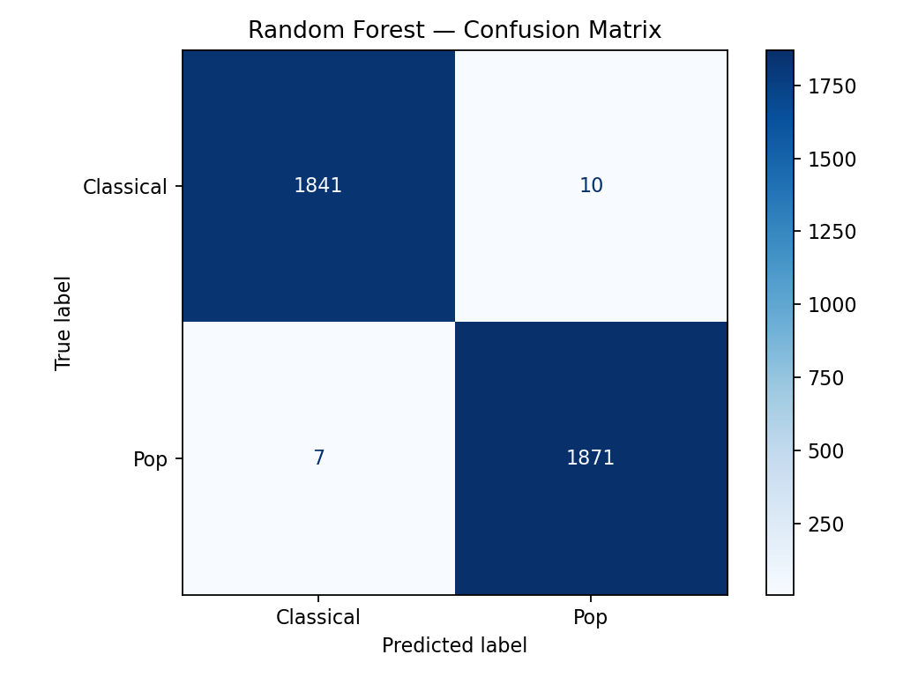
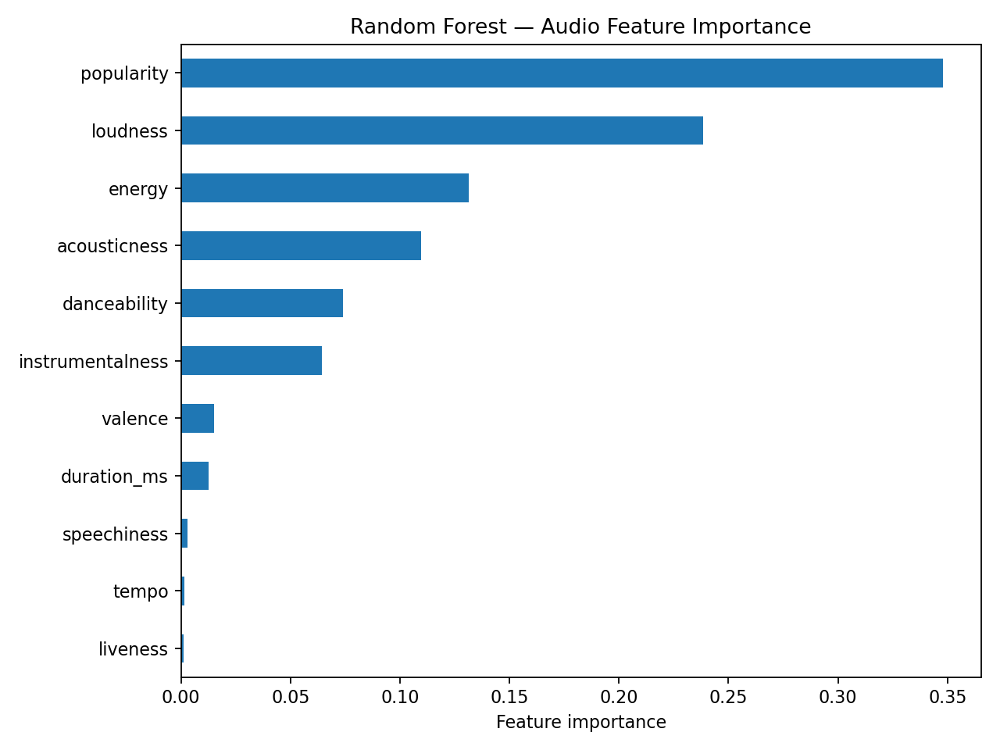

# Spotify Pop vs Classical Classification

A machine learning project that distinguishes Pop and Classical music using Spotify audio features. The project compares Logistic Regression and Random Forest classifiers and evaluates their performance on a held-out test set.

## Dataset

The original Spotify Features dataset contains 232,725 tracks across multiple genres. This experiment focuses on **Pop and Classical**, with 18,642 tracks before preprocessing.

The models use 11 numerical features, including popularity, acousticness, danceability, energy, instrumentalness, loudness, speechiness, tempo, and valence.

The dataset is not included in this repository. Place your own `SpotifyFeatures.csv` file inside `data/` before running the script.

## Methods

- Data filtering and preprocessing
- Stratified train/test split (80% / 20%)
- Logistic Regression with standardized features
- Random Forest classification
- Accuracy, classification report, and ROC-AUC evaluation
- Confusion matrix and feature-importance visualization

## Results

| Model | Test accuracy | ROC-AUC |
|---|---:|---:|
| Random Forest | 99.54% | 0.9998 |
| Logistic Regression | 99.33% | 0.9994 |

Results are specific to this dataset and split. High scores do not necessarily imply equivalent performance on new, independently collected music.

## Visualizations

### Confusion Matrix



### Feature Importance



## Run Locally

Requirements: Python 3 and the packages listed in `requirements.txt`.

```bash
pip install -r requirements.txt
python src/spotify_classifier.py
```

The script reads `data/SpotifyFeatures.csv`, prints the evaluation results, and generates the visualizations and `model-results.csv`.

## Project Structure

```text
spotify-pop-vs-classical/
├── data/                       # Local dataset, excluded from Git
├── figures/
│   ├── confusion-matrix.png
│   └── feature-importance.png
├── src/
│   └── spotify_classifier.py
├── model-results.csv
├── requirements.txt
├── .gitignore
└── README.md
```

Developed as a machine learning classification project.
